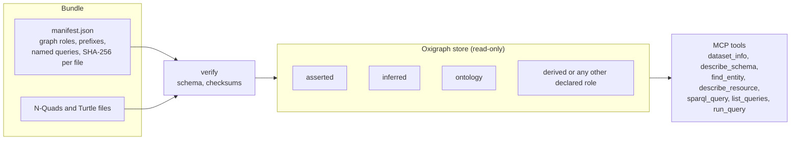

# rdf-kg-mcp

Serve an RDF knowledge graph read-only over the [Model Context Protocol](https://modelcontextprotocol.io), so Claude and other MCP clients can explore and query it.

The graph is a **bundle**: a manifest plus RDF files, with a SHA-256 checksum for each file. Inference is done once, when the bundle is built, and stored as its own named graph. The server loads the bundle into an embedded [Oxigraph](https://github.com/oxigraph/oxigraph) store, so there is no database to run or host.

- Read-only: no SPARQL Update, no federated `SERVICE` calls.
- Asserted and inferred facts are kept apart, and every statement says which graph it came from.
- Pinned versions: the server refuses a bundle whose files do not match the manifest.
- Works with any RDF dataset. Nothing in the server is specific to one domain.



## Quick start

```sh
# Serve a published bundle to Claude Code (downloaded and verified on first start)
claude mcp add my-graph -- uvx rdf-kg-mcp serve https://example.org/my-graph/bundle.tar.gz

# Or a local bundle directory
uvx rdf-kg-mcp serve ./bundle
```

Until the package is on PyPI, install from GitHub instead:

```sh
uvx --from git+https://github.com/rewire-bio/rdf-kg-mcp rdf-kg-mcp serve ./bundle
```

For Claude Desktop or another client, add a server entry that runs the same command:

```json
{
  "mcpServers": {
    "my-graph": {
      "command": "uvx",
      "args": ["rdf-kg-mcp", "serve", "https://example.org/my-graph/bundle.tar.gz"]
    }
  }
}
```

## Tools

| Tool | What it returns |
| --- | --- |
| `dataset_info` | Name, version, manifest checksum, named graphs with their roles and sizes, prefixes, how inferences were produced, validation status |
| `describe_schema` | Classes with instance counts; properties with asserted and inferred counts, labels, definitions, superproperties, inverses, property chains, domains and ranges |
| `find_entity` | Resources whose label matches some text, ranked exact, prefix, word, then substring; optionally limited to a class (inferred types count) |
| `describe_resource` | Every statement about one IRI, outgoing and incoming, each marked asserted, inferred or ontology; paginated |
| `sparql_query` | A read-only SPARQL 1.1 query (SELECT, ASK, CONSTRUCT, DESCRIBE) with a row cap and a timeout |
| `list_queries` | The bundle's named queries: name, title, description, parameters and SPARQL text |
| `run_query` | One named query with its parameters bound, under the same rules as `sparql_query` |

The server also offers the manifest and schema as resources (`kg://manifest`, `kg://schema`) and the bundle's example and named queries as a prompt.

By default `sparql_query` treats the union of all graphs as the default graph, so inferred facts are included. The bundle's prefixes are predeclared, so queries can use them without `PREFIX` lines.

### Named graphs

The manifest maps role names to named-graph IRIs. `asserted`, `inferred` and `ontology` have a fixed meaning to the server. A bundle can declare other roles too, such as `derived` for findings computed from the data. Every declared role:

- is listed by `dataset_info` with its size and description;
- labels statements in `describe_resource`;
- can be passed to `sparql_query`, for example `graphs: ["derived"]` or `graphs: ["asserted", "inferred"]`. Graph IRIs work too.

An unknown role name is refused with the list of roles the bundle declares.

### Named queries

A bundle can ship parameterised SPARQL queries in its manifest, so clients can ask the questions the dataset was built to answer without writing SPARQL. `list_queries` shows them and `run_query` runs one:

```json
{ "name": "owner_of", "params": { "pet": "id:rex" }, "max_rows": 100 }
```

Parameters appear in the query text as `$name`. The server checks each value against its declared type before it goes into the query:

| Type | Accepts | Written into the query as |
| --- | --- | --- |
| `iri` | A full IRI, `<IRI>` or a prefixed name | `<https://...>`, after IRI validation |
| `string` | Any text | An escaped string literal |
| `integer` | A whole number, or a string of digits | Bare digits, so it also works in `LIMIT` |

Values are never copied into the query text as given. An optional parameter with no value and no default is left as an unbound variable. The bound query is checked again for updates and `SERVICE`, then runs with the same timeout and row cap as `sparql_query`. The result includes the SPARQL that ran.

## Command line

```text
rdf-kg-mcp serve BUNDLE [--transport stdio|streamable-http] [--host H] [--port P]
                        [--store memory|disk] [--query-timeout SECONDS] [--max-rows N]
rdf-kg-mcp verify BUNDLE [--quick] [--json]
rdf-kg-mcp manifest DIR --dataset NAME [--version V] [--graph ROLE=IRI ...] [FILES ...]
rdf-kg-mcp pack DIR -o BUNDLE.tar.gz
```

`BUNDLE` is a directory, a `manifest.json`, a `.tar.gz`, or an HTTPS URL of a manifest or archive. Downloads go to `~/.cache/rdf-kg-mcp` (set `RDF_KG_MCP_CACHE` or `--cache-dir` to change it).

- `serve` verifies every checksum before loading. `--store disk` keeps an on-disk store per bundle checksum, so later starts skip loading. SPARQL queries run in a separate worker process; one that passes `--query-timeout` (default 30 seconds) is stopped and the worker restarts. `--query-timeout 0` runs queries in-process with no timeout.
- `verify` checks the manifest against the schema, each file's checksum and, unless `--quick`, each file's statement count. It exits non-zero on any problem, so producers can run it in CI.
- `manifest` writes or refreshes `manifest.json`, filling in checksums and statement counts.
- `pack` writes a byte-reproducible archive: the same bundle always gives the same bytes.

On a graph of about 400,000 statements, loading takes under half a second and each tool call under a tenth of a second; the process uses about 350 MB, plus a second copy in the query worker.

## Making a bundle

Any pipeline that writes RDF files can produce a bundle. A typical layout:

```text
bundle/
  manifest.json
  asserted.nq        # source facts, in the asserted named graph
  inferred.nq        # facts derived by a reasoner, in the inferred named graph
  ontology/*.ttl     # the vocabulary and axioms, loaded into the ontology graph
```

Then:

```sh
rdf-kg-mcp manifest bundle --dataset my-graph --version 2026-10-09 \
  --graph asserted=https://example.org/graph/asserted \
  --graph inferred=https://example.org/graph/inferred \
  --graph ontology=https://example.org/graph/ontology
rdf-kg-mcp verify bundle
rdf-kg-mcp pack bundle -o my-graph-2026-10-09.tar.gz
```

Triples files (`.ttl`, `.nt`, `.rdf`, `.owl`) need a `graph` entry in the manifest to go into a named graph; the `manifest` command keeps any you add by hand. See [docs/bundle-format.md](docs/bundle-format.md) for the full format.

Why inference happens at build time, not in the server: every consumer of the bundle sees the same facts, queries with `LIMIT` and `FILTER` behave correctly, and the inferred graph can be reviewed and versioned like any other data.

## Security

- The server never writes to the store, and queries cannot modify it.
- `SERVICE` is refused, so a query cannot make the server send requests elsewhere.
- Archives with links, absolute paths or `..` entries are refused.
- Over `streamable-http` the server has no authentication of its own. Bind it to localhost (the default) or put it behind a proxy that authenticates.

## Development

```sh
uv sync
uv run pytest
uv run ruff check . && uv run ruff format --check .
uv run pyright
```

## Licence

MIT. See [LICENSE](LICENSE).
